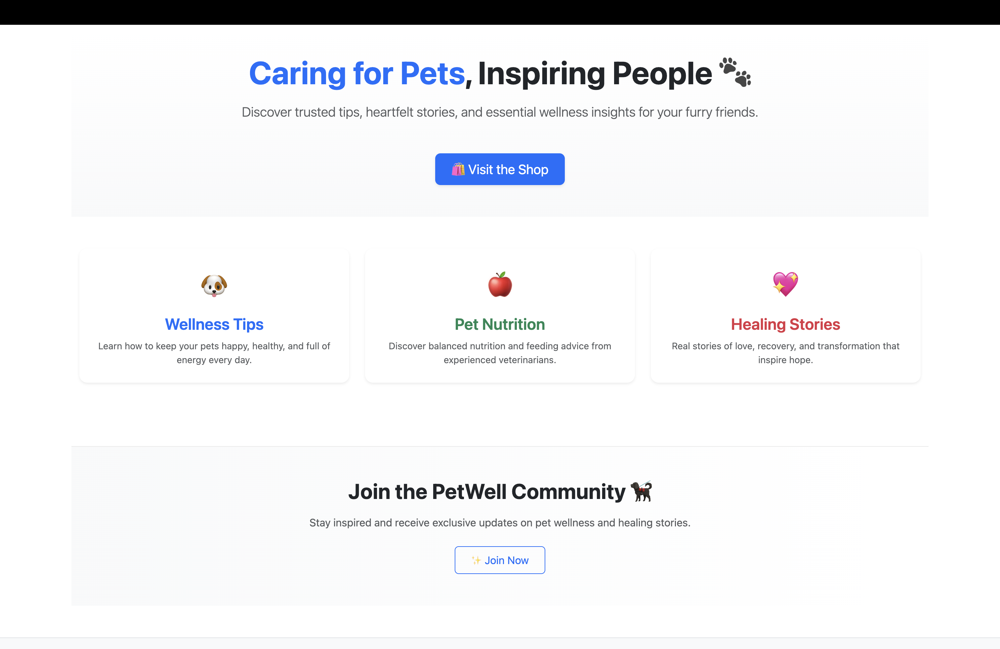
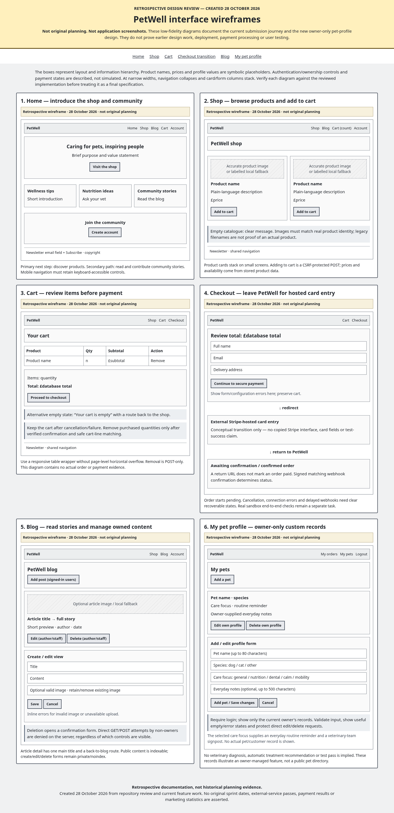
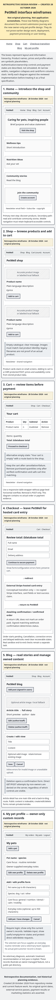
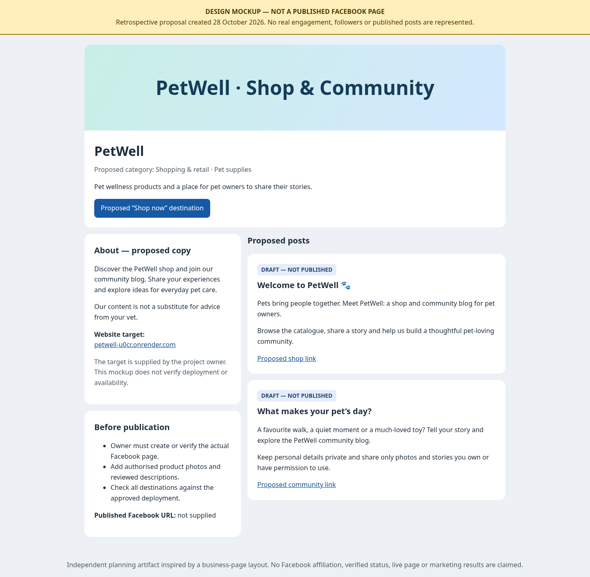
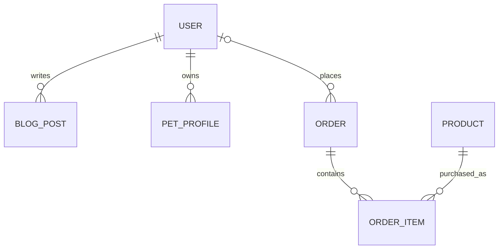

# PetWell 🐾
### Pet wellness store & community

[**Visit the shop**](https://petwell-u0cr.onrender.com/) · [Shop products](https://petwell-u0cr.onrender.com/products/) · [Read the blog](https://petwell-u0cr.onrender.com/blog/) · [Technical testing](docs/TESTING.md) · [**Public Agile board**](https://github.com/users/bobes81/projects/3)

PetWell is a responsive online shop and community for people who care about their pets' everyday wellbeing. It brings a curated pet-care catalogue, secure card checkout, educational blog posts, personal pet profiles and customer order history into one Django-powered experience.

## Contents

1. [The idea](#the-idea)
2. [Customer experience](#customer-experience)
3. [Features](#features)
4. [Design and user experience](#design-and-user-experience)
5. [Business model and marketing](#business-model-and-marketing)
6. [How the application works](#how-the-application-works)
7. [Data model and security](#data-model-and-relationships)
8. [Technology](#technology)
9. [Getting started locally](#getting-started-locally)
10. [Deploying to Render](#deploying-to-render)
11. [Testing and quality assurance](#testing-and-quality-assurance)
12. [Limitations and future development](#limitations-and-future-development)
13. [Credits](#credits)

## The idea

Pet owners often need different services for shopping, finding practical pet-care advice and keeping track of their animals' routines. PetWell combines these activities in a straightforward, welcoming site.

**Purpose:** provide a clear path from product discovery to secure checkout while encouraging visitors to return for the blog, personal pet profiles and future purchases.

**Audience:** pet owners looking for accessible everyday pet-care products and advice, including returning customers who want to see previous purchases and reorder.

**Key goals**

- Make products, prices and availability easy to understand.
- Offer a trustworthy checkout that never stores customers' card details in PetWell.
- Help registered members maintain their own content, profiles and order information.
- Protect private data and prevent users from editing someone else's content.
- Offer useful content and responsible, consent-based marketing.

## Customer experience

### Shopping

*Product image contact sheet prepared for the PetWell catalogue; this is an asset overview, not a screenshot of the deployed shop.*

1. **Explore:** visit the homepage or the shop, browse product descriptions, prices and imagery.
2. **Choose:** add an available product to the basket or remove an item. Adding the same product again increases its quantity; there is no separate quantity-edit form.
3. **Review:** see basket items and the current total, calculated from catalogue data on the server.
4. **Checkout:** enter contact and delivery details and continue to Stripe's hosted payment page.
5. **Confirmation:** after a successful payment, the order is marked paid only when the application receives a verified Stripe event. Returning from Stripe alone is not evidence of payment.
6. **Return:** signed-in customers can inspect their own order history, including pending and paid orders. **Buy again** is available for paid orders and builds a new basket using current product prices.

The catalogue includes physical pet-care items. Unavailable products are withheld from new purchases without destroying historical orders.

### Community and personalisation

Members can publish and manage blog posts, maintain private profiles for their pets, and access their own orders. Visitors can read public posts and register for a customer account; newsletter registration is available separately.

## Features

| Feature | What it does | Who can use it |
| --- | --- | --- |
| Product catalogue | Displays descriptions, prices and current availability, with image fallbacks | Visitors |
| Basket | Add products (including repeated additions) and remove products from a server-validated session basket | Visitors |
| Stripe Checkout | Hosted card payment with server-computed GBP line items | Customers |
| Order confirmation | Stores pending/paid states; verifies signed Stripe webhook before marking paid | Customers |
| Customer accounts | Sign up, log in, log out, request password reset | Visitors/members |
| My orders / Buy again | View own pending and paid orders; use **Buy again** on paid orders at current prices | Signed-in customers |
| Community blog | Read articles; create, edit and delete own posts | Readers/authors |
| My pets | Save pet name, species, care focus and notes; view a routine prompt; edit/delete | Signed-in owners |
| Newsletter subscription | Validate and store unique email subscriptions | Visitors |
| Administration | Manage catalogue and application data through Django Admin | Authorised staff |
| Search visibility | Page-specific metadata, canonical URLs, robots and sitemap | Search engines |

**Email delivery note:** newsletter addresses are stored; sending a marketing campaign is not implemented. On 30 October 2026, the deployed SMTP backend successfully sent a test message which was independently verified in the destination mailbox. This confirms outbound SMTP delivery, not the entire password-reset or signup email journey. The currently configured sender uses a temporary Gmail address.

### Pet profiles — a custom feature

**My pets** is a dedicated, owner-only feature rather than a standard shopping model. A registered customer can add a pet, choose a care focus, read a matching routine prompt, update the details or remove the profile. Server-side ownership checks protect direct URLs and form submissions: a different user cannot access the pet's information simply by guessing an address.

**Agile evidence:** The [public PetWell Kanban project board](https://github.com/users/bobes81/projects/3) tracks 14 linked GitHub User Stories (12 completed, 2 open). Issues and [the story-to-criteria mapping](docs/USER_STORIES.md) were assembled retrospectively on 31 October 2026; they do not claim to document the original sprint history.

## Design and user experience

The visual direction combines a friendly pet-wellness theme with familiar commerce patterns: clear navigation, readable product cards, an obvious basket journey, concise forms and responsive layouts.

**Design priorities:** usable on mobile and desktop; consistent menus and buttons; visible feedback for invalid form data; helpful empty states; confirmation before destructive blog/profile actions; and graceful image fallbacks.

### Visual identity and design decisions

PetWell uses a **soft blue, white and neutral-grey** visual language intended to feel clean, friendly and dependable rather than clinical. The actual site styles use a pale background (`#f9fbfd`), dark body text (`#333333`), blue calls to action (`#0d6efd`) and light-blue/cyan accents (`#00b4d8`). White card surfaces and subtle shadows separate product and information blocks from the page background.

The project styles specify **Inter** with system sans-serif fallbacks for body text. Bootstrap provides the consistent grid, navigation, form controls and responsive breakpoints. Rounded calls to action, generous spacing and visible focus outlines support clear interaction on both desktop and mobile.

The checkout path deliberately keeps card entry on **Stripe's hosted page** instead of presenting a custom card form. Destructive blog/profile actions include confirmation, while unavailable products are excluded from purchasing. These choices connect the visual design to trust, accessibility and safe behaviour.

### Page layouts and wireframes

These diagrams document the implemented user journeys as a **retrospective design review**. They are genuine design artefacts, not claims of original pre-development sketches or screenshots of the deployed website.

**Desktop layout**

**Mobile layout**

The diagrams cover the homepage, shop, basket/Stripe transition, blog and personal pet profiles. An [editable HTML version](docs/design/wireframes.html) and [design notes](docs/design/README.md) are also available.

### User stories and delivery priorities

Examples of product-centred user stories:

| Priority | User story | Implemented outcome |
| --- | --- | --- |
| Must | As a visitor, I want to compare pet-care products so I can decide what to buy. | Product listings, details, prices, availability |
| Must | As a customer, I want to pay securely so my card is handled by a payment provider. | Hosted Stripe Checkout, signed confirmation |
| Must | As an author, I want to edit or remove only my own posts. | Owner/staff permission checks on read and write routes |
| Must | As a member, I want my pet notes to remain private. | Ownership-scoped profile CRUD |
| Should | As a returning customer, I want to review an order and buy the items again. | Private order history and **Buy again** |
| Should | As a visitor, I want useful articles about pet wellbeing. | Public blog and article pages |
| Could | As an interested visitor, I want to hear about future offers. | Newsletter email registration, without campaign delivery |

For a larger feature breakdown and prioritisation, see [user stories](docs/USER_STORIES.md). The diagrams and feature evidence in this repository describe the delivered product rather than inventing a past sprint history.

## Business model and marketing

PetWell uses a **business-to-consumer (B2C)** online retail model. Products are presented with descriptions and GBP prices; the purchase funnel is **discover → basket → Stripe payment → confirmed order → potential repeat purchase**.

- **Product strategy:** accessible pet-wellness items supported by clear descriptions and suitable imagery.
- **Content strategy:** useful blog articles establish the brand's voice and help visitors return independently of a purchase.
- **Retention:** customer order history, **Buy again** and personal pet profiles create reasons for members to revisit.
- **Search engine optimisation:** descriptive page titles, metadata, canonical URLs, a sitemap and robots guidance improve discoverability.
- **Social media concept:** a proposed Facebook business page provides a visual direction for future posts and outreach; it is a mockup, **not a published page or evidence of followers**.
- **Newsletter:** validated signups can support future permission-based communications; automated campaigns are not claimed.

### Facebook page concept

This is a labelled design concept rather than a live Facebook page. The [editable mockup](docs/marketing/facebook-mockup.html) and [mobile presentation](docs/marketing/facebook-mockup-mobile.png) are included.

No customer conversion rates, sales volumes, published social campaigns or email marketing deliveries are claimed without supporting records.

## How the application works

PetWell is a server-rendered Django application, split into focused apps:

- **products:** catalogue, images, prices and availability checks.
- **cart:** session-based basket operations.
- **checkout:** hosted Stripe Session creation, signed webhook verification and confirmation page.
- **orders:** order/order-item records, customer history, **Buy again** and checkout coordination.
- **accounts:** authentication integration and private pet profiles.
- **blog:** public articles, author-controlled content and newsletter subscribers.
- **petwell:** shared settings, routing, templates and SEO.

### Payment sequence

1. The customer's basket is validated against the current product database; items cannot be purchased using browser-supplied prices.
2. An order is created as **pending**, with an immutable snapshot of line items and the Stripe Session request.
3. A hosted Stripe Checkout Session is created or safely recovered using an idempotency key. The customer is redirected to Stripe to enter card details.
4. A webhook is accepted only when its Stripe signature is valid and the Session reference, amount, currency, mode and environment match the recorded order.
5. The order changes to **paid** after verified successful payment. Returning from Stripe does **not** itself mark an order paid.
6. Paid items are reconciled against the original basket items rather than indiscriminately clearing unrelated later additions.

Checkout error and retry paths keep basket contents where appropriate. Browser sessions and database coordination help avoid parallel duplicate payment attempts. The tests exercise these application rules; they do not mean all external Stripe failure conditions were observed in production.

### Data model and relationships

The application uses Django's user model alongside custom Product, BlogPost, Subscriber, PetProfile, Order, OrderItem and internal CheckoutState models.

The following simplified relationship diagram is illustrative; the [complete, implemented Mermaid ER diagram](docs/MODELS.md) includes actual model fields and relationships.

| Relationship | Purpose |
| --- | --- |
| User → BlogPost | Tracks the author and controls edits/deletes |
| User → PetProfile | Keeps each member's pet notes private |
| User → Order → OrderItem | Preserves customer purchases and per-item purchase prices |
| Product → OrderItem | Keeps historical orders linked to purchased products |
| Order ↔ CheckoutState | Coordinates an active checkout attempt for a browser session |
| Subscriber | Stores a unique email address independently of accounts |

#### Entity-relationship overview

The diagram below shows the main customer-facing relationships. The complete schema additionally documents the internal checkout coordinator and field-level details.

See [full entity-relationship diagram](docs/MODELS.md) for field-level detail, historical migration handling and deletion rules.

### Authentication, permissions and security

- Django and django-allauth provide registration and authentication.
- Blog authors can edit/delete their own posts; staff moderation is controlled separately.
- Pet profiles and order history are scoped to the authenticated owner, including direct URL access.
- State-changing forms use CSRF protection; deployment enables HTTPS redirection, secure cookies and HSTS.
- API credentials and Django secrets are read from environment variables, never placed in source control.
- Checkout prices come from the database. Stripe handles card entry; PetWell does not store card numbers.
- A Stripe return URL alone cannot confirm a successful charge.

## Technology

| Layer | Technology |
| --- | --- |
| Backend | Python 3.11, Django 5.2 |
| Database | PostgreSQL (Render); SQLite for local development |
| Payments | Stripe Checkout and signed webhooks |
| Media | Cloudinary |
| Front end | Django templates, HTML5, CSS3, Bootstrap 5.3, JavaScript |
| Authentication | django-allauth |
| Static assets | WhiteNoise |
| Hosting | Render |
| Version control / CI | GitHub, GitHub Actions |

Exact package versions are pinned in [requirements.txt](requirements.txt).

## Getting started locally

### Requirements

- Python 3.11 and Git
- A terminal and virtual environment support
- Optional: PostgreSQL, Stripe test credentials and a Cloudinary account for external integrations

### Clone and install

~~~bash
git clone https://github.com/bobes81/Petwell.git
cd Petwell
python3.11 -m venv venv
source venv/bin/activate
python -m pip install --upgrade pip
python -m pip install -r requirements.txt
~~~

For Windows, activate the environment with `venv\Scripts\activate` (Command Prompt) or `.\venv\Scripts\Activate.ps1` (PowerShell).

### Set local environment variables

The application reads process environment variables; it does not automatically load a `.env` file. The following local-only configuration uses SQLite, console email and a fresh development secret. Do **not** paste real credentials into the repository.

~~~bash
export DEBUG=True
export SITE_URL=http://localhost:8000
export ALLOWED_HOSTS=localhost,127.0.0.1
export EMAIL_BACKEND=django.core.mail.backends.console.EmailBackend
export SECRET_KEY="$(python -c 'from django.core.management.utils import get_random_secret_key; print(get_random_secret_key())')"
unset DATABASE_URL
~~~

On Windows PowerShell, use `$env:NAME = "value"`; remove an existing remote database variable using `Remove-Item Env:DATABASE_URL -ErrorAction SilentlyContinue`.

### Prepare the database and run

~~~bash
python manage.py migrate
python manage.py shell -c 'from products.seed import run; run()'
python manage.py collectstatic --noinput
python manage.py createsuperuser
python manage.py runserver
~~~

Open **http://localhost:8000/** and use **http://localhost:8000/admin/** for the Django administration panel.

The local seed adds sample physical-product listings for development. Seeded listings may not have genuine product images. Do not seed the production database, and do not interpret sample data as real inventory.

**Local payment behaviour:** without configured Stripe test credentials and a matching webhook signing secret, payment cannot be completed. The app should show a recoverable error rather than silently charging a card. Use Stripe sandbox/test mode only when testing payments.

## Deploying to Render

This deployment is a **Python web service with a PostgreSQL database**. The same steps can be used for a new instance after providing your own service credentials.

1. **Prepare the repository.** Push the application code and pinned `requirements.txt` to GitHub. Confirm `build.sh`, `manage.py` and `petwell/wsgi.py` are present.
2. **Create PostgreSQL.** In Render, create a PostgreSQL instance and copy its private **Internal Database URL** to the web service's `DATABASE_URL` environment variable. Preserve database backups before changing a populated schema.
3. **Create the web service.** Connect the GitHub repository, select Python, and choose an appropriate Python 3.11 runtime. Use build command `./build.sh` and start command `gunicorn petwell.wsgi`. The build script installs dependencies, gathers static files and applies Django migrations; do not run the same production migrations manually without reviewing the release procedure.
4. **Configure the host.** Set `DEBUG=False`, a strong private `SECRET_KEY`, `SITE_URL=https://YOUR-SERVICE.onrender.com` and `ALLOWED_HOSTS=YOUR-SERVICE.onrender.com`. Adjust these values if using a custom domain.
5. **Configure media.** Add your Cloudinary `CLOUDINARY_URL` credential and verify that images upload and render over HTTPS. Existing production image references are not portable to an unrelated Cloudinary account automatically.
6. **Configure Stripe test payments.** Set `STRIPE_SECRET_KEY` to a Stripe **test** key, `STRIPE_LIVE_MODE=False`, and `STRIPE_WEBHOOK_SECRET` to the destination's signing secret. Configure the Stripe webhook URL `https://YOUR-SERVICE.onrender.com/checkout/webhook/` for `checkout.session.completed` and `checkout.session.async_payment_succeeded`. Never mix test and live keys or use a real card for a test.
7. **Configure email.** Set `EMAIL_BACKEND` and the appropriate `EMAIL_HOST`, `EMAIL_PORT`, `EMAIL_HOST_USER`, `EMAIL_HOST_PASSWORD`, `EMAIL_USE_TLS`/`EMAIL_USE_SSL` and `DEFAULT_FROM_EMAIL` for the chosen provider. Test an actual password-reset email before saying transactional delivery works. If SMTP is unavailable, the console backend only logs messages and cannot deliver them.
8. **Deploy and inspect logs.** Ensure the build succeeds, migrations complete, there are no pending migrations, and the expected hostname serves the homepage, shop, `robots.txt` and `sitemap.xml`.
9. **Create authorised admin access** if none exists, using `python manage.py createsuperuser` in a secure service shell. Never commit or publish account passwords.
10. **Complete acceptance checks:** images, navigation, basket, Stripe sandbox checkout and webhook delivery, order history, user permissions, blog and pet CRUD, mobile layouts and email. Record actual results rather than treating a completed deploy as a full functional test.

The application supports the deployed Render URL shown at the top of this README. For a populated instance or recovery, refer to the [release runbook](docs/RELEASE_RUNBOOK.md) and [Render configuration guide](docs/RENDER_CHECKLIST.md); do not overwrite a live database with local sample fixtures.

### Environment variable reference

| Variable | Required for | Notes |
| --- | --- | --- |
| `SECRET_KEY` | Production | Keep secret, persistent and unique |
| `DEBUG` | Production | `False` |
| `DATABASE_URL` | PostgreSQL | Render connection URL; never commit |
| `SITE_URL` | Correct URLs and Stripe | Full HTTPS origin, no trailing slash |
| `ALLOWED_HOSTS` | Host validation | Comma-separated domain names |
| `CLOUDINARY_URL` | Image media | Private Cloudinary connection URL |
| `STRIPE_SECRET_KEY` | Checkout | Stripe test key for sandbox |
| `STRIPE_WEBHOOK_SECRET` | Order confirmation | Secret for the exact webhook destination |
| `STRIPE_LIVE_MODE` | Payment environment | `False` for sandbox |
| `EMAIL_BACKEND` | Email | SMTP backend for actual delivery |
| `EMAIL_HOST` / `EMAIL_PORT` | Email | Provider hostname and port |
| `EMAIL_HOST_USER` / `EMAIL_HOST_PASSWORD` | Email | Authentication; keep private |
| `EMAIL_USE_TLS` / `EMAIL_USE_SSL` | Email | Choose the provider's supported encryption |
| `DEFAULT_FROM_EMAIL` | Email | Verified sender address |

## Testing and quality assurance

The project uses automated regression tests, GitHub CI, manual browser reviews and targeted external-service checks. Different types of evidence are kept separate.

**Verified automated baseline:** the main code revision passed **215 SQLite tests (one PostgreSQL-only skip)** and **216/216 PostgreSQL 18.6 tests** in the final local audit. GitHub Actions for commit `dde85fe` passed its SQLite and PostgreSQL 16/18 jobs: [view workflow run](https://github.com/bobes81/Petwell/actions/runs/41089034654). Application-level Stripe tests include signed payloads, idempotent sessions, error handling and order transitions; they mock external provider operations where appropriate.

**Actual hosted payment evidence:** one owner-performed **GBP 11.49 Stripe sandbox checkout** completed and the corresponding production database order was marked paid. This does not constitute a live-card charge or exhaustive provider-side failure/replay testing.

### Reproduce automated checks

~~~bash
python manage.py test --settings=petwell.test_settings
python manage.py check --settings=petwell.test_settings
python manage.py makemigrations --check --dry-run --settings=petwell.test_settings
python manage.py collectstatic --noinput
~~~

Local tests use isolated test settings, not a production database, and must never be pointed at real customer records. CI runs additional PostgreSQL-specific checks against disposable databases.

### Functional testing examples

| Scenario / steps | Expected result | Recorded result and scope |
| --- | --- | --- |
| Browse shop and open product pages | Available products and current prices render without broken navigation | **PASS** in local browser review; owner reviewed live shop/cart |
| Add an item (including adding it again), remove it | Basket reflects additions, repeated additions and removal at correct totals; no separate quantity-edit form | **PASS** in local tests/browser flows; live shop/cart owner-reviewed |
| Complete hosted Stripe sandbox checkout | Stripe receives test card; verified event marks the order paid | **PASS** for one GBP 11.49 owner-performed sandbox purchase and saved paid order |
| Submit a forged or mismatching payment webhook | Payment is rejected; order remains pending | **PASS** in automated signed-webhook regressions; not a live provider attack test |
| Sign up, log in and log out | User can authenticate and returns to the expected pages | **PASS** in local browser tests; production transactional email remains unverified |
| Create, edit or delete own blog post | Changes persist and no server error occurs | **PASS** in local/browser and automated tests |
| Try another user's blog edit URL | Access is rejected, including direct GET/POST requests | **PASS** in automated permissions and local browser checks |
| Add, update, delete a pet profile | Owner sees own data; other users cannot retrieve it | **PASS** in local browser/automated tests |
| View order history and Buy again | Only own orders visible; repeated basket uses current prices | **PASS** in local tests and synthetic browser fixtures |
| Visit `/robots.txt` and `/sitemap.xml` | URLs reference the configured site, and public pages are listed | **PASS** in route tests; external deployed crawl not independently verified |
| Send an SMTP test message from deployed Django | The message is accepted and received in a controlled mailbox | **PASS:** `send_mail` returned 1; the test message appeared in the recipient Gmail inbox on 30 October 2026. This does **not** verify password-reset token/link flow |
| View wireframes and marketing mockup | Images render in repository documentation | Assets stored in `docs/design/` and `docs/marketing/`; not live campaign evidence |

**Validation and evidence:** actual HTML/CSS validation runs, local desktop/mobile browser captures and scope-limited accessibility results are documented in [the testing log](docs/TESTING.md) and [evidence checklist](docs/EVIDENCE.md). Refer to the [saved local validation summary](docs/evidence/29oct-final-validation-summary.json) for the machine-readable result; this is not a deployed-site Lighthouse or cross-browser certificate. The [GitHub Actions run](https://github.com/bobes81/Petwell/actions/runs/41089034654) provides reproducible CI evidence.

## Limitations and future development

- **Transactional emails:** SMTP sending and real inbox receipt were verified on 30 October 2026 with a temporary personal Gmail sender. The full welcome-email and password-reset link/change-password flows remain unverified on the hosted service; the sender should later be replaced with an appropriate dedicated address.
- **Newsletter:** signup stores validated addresses but does not yet send campaign emails.
- **Fulfilment:** checkout records payment; it does not provide warehouse dispatch, shipment tracking, digital download fulfilment or automatic refunds. Product availability must reflect what can genuinely be supplied.
- **Inventory:** no stock-quantity reservation system; availability is controlled by a product flag.
- **Payments:** a genuine sandbox success and comprehensive automated tests exist, but production live-card processing, provider-side retries and all decline paths are not independently confirmed.
- **Marketing:** Facebook artefacts are proposals, not live published brand pages or campaign metrics.

Possible enhancements include stock management, shipping updates, a dedicated transactional email service, consent-managed newsletters, richer pet reminders and broader accessibility/cross-browser acceptance.

## Credits

PetWell is an independently developed learning and portfolio application using Django, Bootstrap, Stripe, Cloudinary and the other credited open-source packages. AI tools, including ChatGPT and OpenAI Codex, supported implementation, debugging, testing, design review and documentation. Third-party dependencies retain their respective licences; Bootstrap's licence is included in the repository.

Selected design graphics, wireframes and marketing concepts are stored with the code; their stated role is illustrative rather than proof of earlier research or published marketing. Product listings and images require appropriate owner review for accuracy, provenance and permission.

---

**PetWell — thoughtful shopping and everyday care for the pets we love.**