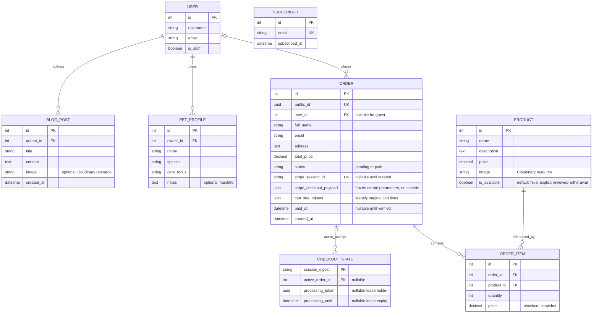

# Current data model

This diagram describes the implemented models; it is not a wireframe or evidence of earlier planning. Django/allauth manage the user, account/email, permissions, sessions and sites tables.

Deleting a user removes their posts and pet profiles and sets their orders' user link to null. Deleting an order removes its items, but an order referenced by a CheckoutState cannot be deleted because that foreign key is protected. A product referenced by an order item also cannot be deleted. Subscriber records are independent of user accounts. Reordering does not modify old records or prices and does not initiate payment. The admin additionally disables order deletion, including records not currently referenced by a checkout coordinator.

The UUID migration first adds a nullable field, assigns a distinct value to every historical row, then enforces uniqueness/non-nullability. Historical orders become pending rather than assuming they were paid. The migration regression test exercises multiple existing rows.

Migration `0004` adds JSON snapshots without inferring missing legacy payment data. Legacy no-response/no-payload attempts get fresh keys, and legacy lines without identities are not automatically removed from carts. Admin order deletion is disabled so payable/paid orders retain their webhook/history record.

`accounts.0001` creates the owner-only PetProfile model and frontend feature. `orders.0005` creates CheckoutState: an internal session-scoped lease/pointer, not a substitute for the user-facing custom model. API I/O occurs outside the short database transaction; expired leases can recover durable order snapshots.

`products.0002` adds availability without automatically withdrawing a row. Catalogue/direct cart/stale cart/checkout/reorder reject withdrawn or nonpositive-priced items; OrderItems and legitimate signed payment confirmation remain intact. The later actual six-migration real-backup rehearsal and owner-verified 30 October production application now complete the schema/migration check. Actual exact-row PDF withdrawal remains separate and unverified; [deployment evidence](evidence/30oct-production-deployment.md).
