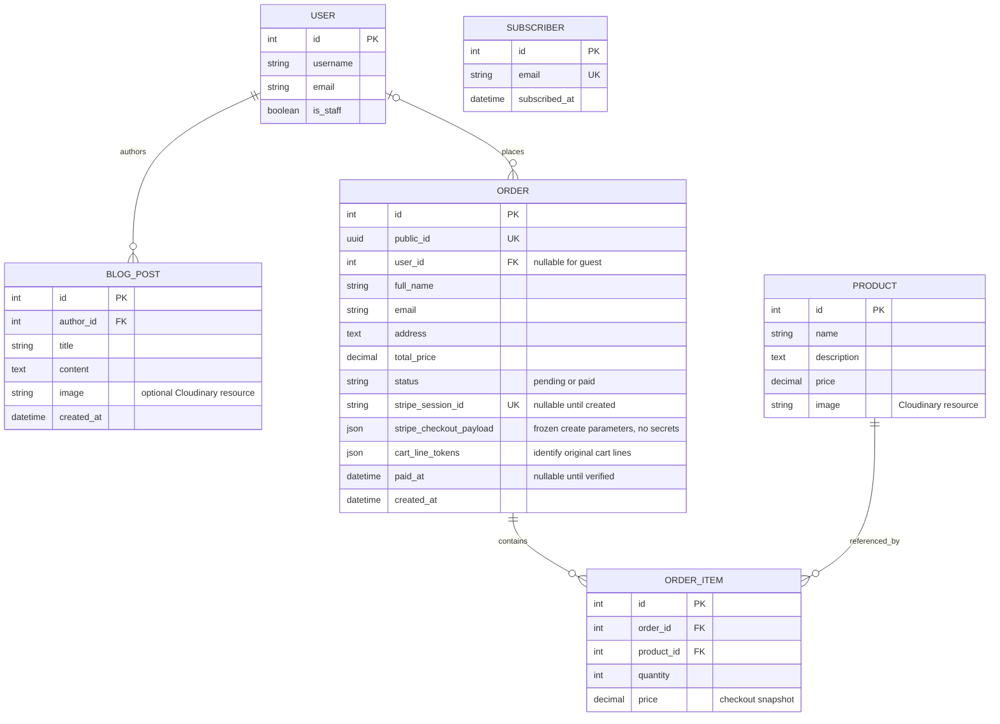

# Current data model

This diagram describes the implemented models; it is not a wireframe or evidence of earlier planning. Django/allauth manage the user, account/email, permissions, sessions and sites tables.

Deleting a user removes their posts and sets their orders' user link to null. Deleting an order removes its items. A product referenced by an order item cannot be deleted. Subscriber records are independent of user accounts. Reordering does not modify old records or prices and does not initiate payment.

The UUID migration first adds a nullable field, assigns a distinct value to every historical row, then enforces uniqueness/non-nullability. Historical orders become pending rather than assuming they were paid. The migration regression test exercises multiple existing rows.

Migration `0004` adds JSON snapshots without inferring missing legacy payment data. Legacy no-response/no-payload attempts get fresh keys, and legacy lines without identities are not automatically removed from carts. Admin order deletion is disabled so payable/paid orders retain their webhook/history record.
